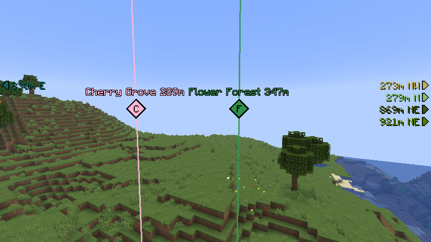
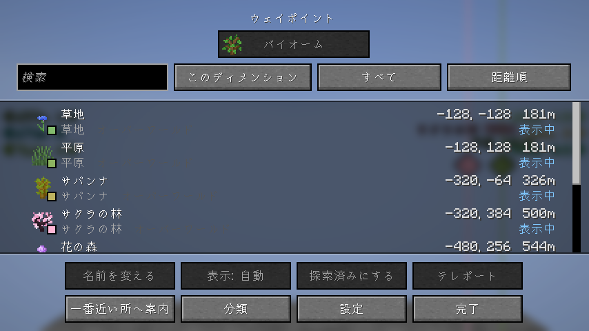
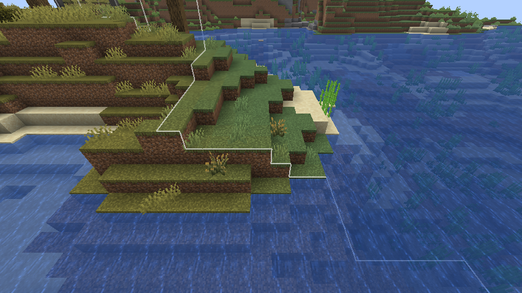
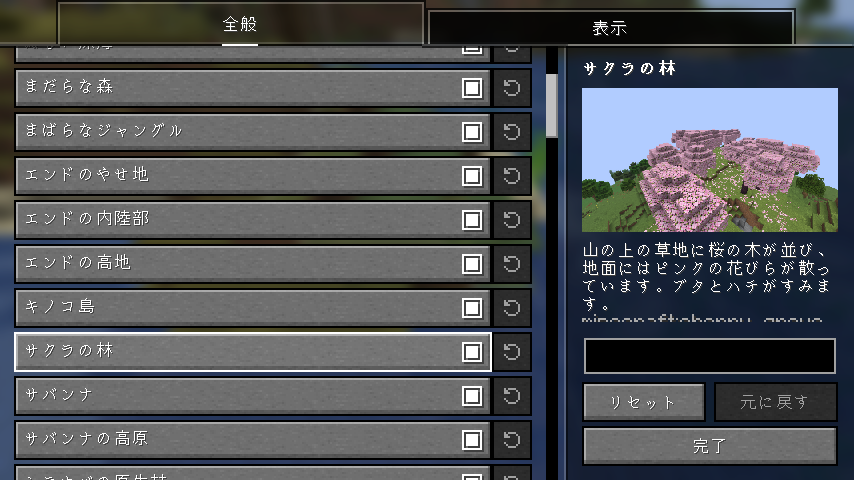

# Biome Waypoints

[English](README.md) | 日本語

選んだバイオームのいちばん近い場所をワールドのシードから探し、ウェイポイントとして表示する Fabric 向けクライアント MOD です。
クライアントに入れるだけで動作し、バニラサーバーでも使えます（サーバー側への導入は不要です）。

## 機能

### バイオームを探す

バイオームごとのいちばん近い場所を、`/locate biome` と同じ方法でシードから求めます（6400 ブロック先まで）。先に歩き回って探索する必要はありません。

- **探すバイオーム**: 初期状態では、ゲームのすべてのバイオームと、MOD やデータパックが足したバイオームを探します。要らないバイオームはチェックを外せます。
- **オーバーワールドとネザー**: 両方を一緒に探します。もう一方のディメンションは、つながる先の位置から探します。
- **探し直し**: 今いる場所から、設定した距離（初期値は 256 ブロック）動くたびに探し直します。
- **探索済み**: ウェイポイントは、見つけた場所のまわりに広がるバイオーム全体を指します。その中に入ると、ウェイポイントが探索済みになり、トーストが出ます。

### ウェイポイント

場所の表示は [Waypoints API](https://github.com/LivingDeadDolls/WaypointsAPI) が担当します。同じ jar に入っています。

- **ワールドの中**: バイオームの色の光の柱と、バイオームの頭文字を出すひし形、名前と距離のラベル、見えていないウェイポイントを指す画面の端の矢印。
- **一覧**: 検索・絞り込み・並び替え。名前の変更、ピン留め、表示しない、テレポート（コマンドを使える人だけ）、一番近い所への案内。
- **地図の MOD**: [JourneyMap](https://modrinth.com/mod/journeymap) の全体地図と、[Xaero's World Map](https://modrinth.com/mod/xaeros-world-map)（Xaero's Minimap と一緒に）のワールドマップに印として出ます。一覧から、JourneyMap・[Xaero's Minimap](https://modrinth.com/mod/xaeros-minimap)・[VoxelMap](https://modrinth.com/mod/voxelmap-updated) のウェイポイントに足せます。

### バイオームの境目

まわりのバイオームが接する所に、地面に細い線を引きます（64 ブロック以内。遠いほど薄くなります）。ネザーでは引きません。オフにもできます。

### シード

ワールドのシードが必要です。

- シングルプレイと、LAN に公開したワールドでは、入ってすぐにシードが分かります。
- サーバーでは、`/setseed <シード>` で入力します。サーバーが許していれば `/seed` でも分かります。シードはサーバーごとに覚えます。

シードが分からない間と、届いた地形とシードが合わないとき（入力を間違えた場合など）は、探しません。

## 設定

設定画面は [Mod Menu](https://modrinth.com/mod/modmenu) から開きます。

- **全般**: 探すバイオーム（バイオームごとに画像と説明つき）、探し直す距離、境目の線。
- **表示**: ウェイポイントを出す距離と数、バイオームごとの表示・色・いちばん近いものだけを出すかどうか。

キー（一覧を開く、ウェイポイントの表示の切り替え）は Waypoints API のもので、初期状態では割り当てがありません。操作設定の「Waypoints API」で割り当ててください。

## 必要なもの

- [Fabric API](https://modrinth.com/mod/fabric-api)
- [YetAnotherConfigLib](https://modrinth.com/mod/yacl)
- [Mod Menu](https://modrinth.com/mod/modmenu)（任意。設定画面を開くのに使います）

Waypoints API と [Seed Engine API](https://github.com/LivingDeadDolls/SeedEngineAPI) は jar に入っています。
対応する Minecraft のバージョンは各リリースに記載しています。

## 注意

シードからバイオームを探すので、まだ行っていない場所が分かります。サーバーによっては、このような MOD の使用をルールで禁止していることがあります。
使用はサーバーのルールに従ってください。
