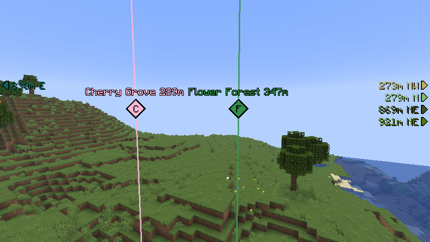
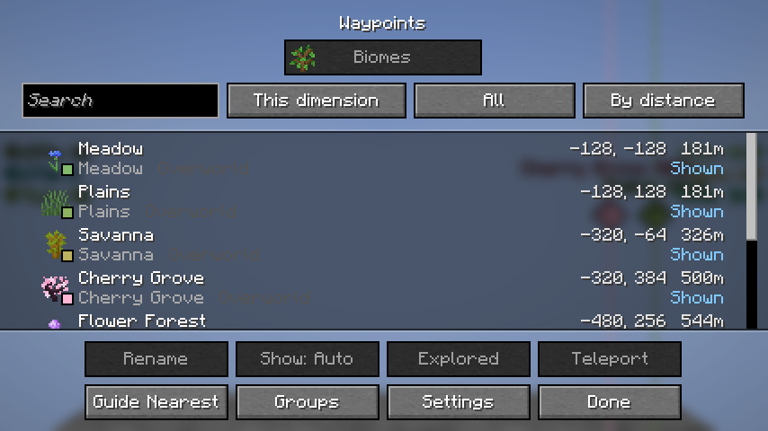
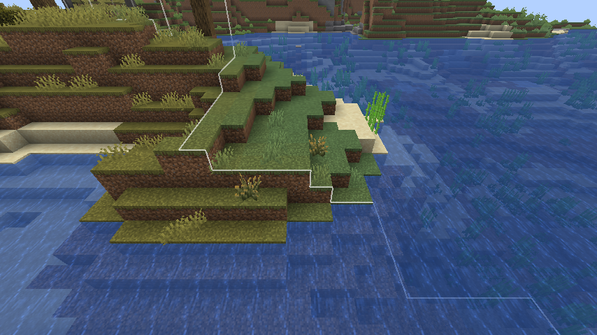
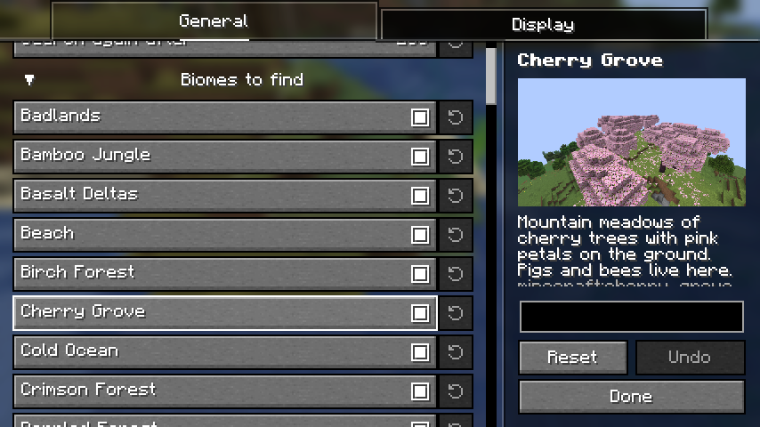

# Biome Waypoints

English | [日本語](README.ja.md)

A client-side Fabric mod that finds the biomes you pick from the world's seed and shows the nearest of each as a waypoint.
Just install it on your client; it also works on vanilla servers (nothing needs to be installed on the server).

## Features

### Finding biomes

The nearest place of each biome is worked out from the seed, the way `/locate biome` finds it (up to 6400 blocks away), so you do not have to explore first.

- **Biomes to find**: every biome of the game at first, and those that mods and data packs add. Untick the ones you do not want.
- **Overworld and Nether**: both are searched together, the other one from the place that leads there.
- **Searching again**: from where you are, after you move 256 blocks (changeable).
- **Explored**: a waypoint covers the stretch of the biome around the place found. Going into it marks the waypoint explored, with a toast.

### Waypoints

The places are shown by [Waypoints API](https://github.com/LivingDeadDolls/WaypointsAPI), which comes in the same jar.

- **In the world**: a beam in the biome's color with a diamond that shows the biome's initial, a label with the name and distance, and arrows at the screen's edges for the waypoints out of sight.
- **The list**: search, filters and sorting. Rename, pin, hide, teleport (when you may run commands) and a guide to the nearest one.
- **Map mods**: they are marks on the fullscreen map of [JourneyMap](https://modrinth.com/mod/journeymap) and on the world map of [Xaero's World Map](https://modrinth.com/mod/xaeros-world-map) (with Xaero's Minimap). The list can add one to the waypoints of JourneyMap, [Xaero's Minimap](https://modrinth.com/mod/xaeros-minimap) or [VoxelMap](https://modrinth.com/mod/voxelmap-updated).

### Biome borders

Thin lines on the ground show where the biomes around you meet (within 64 blocks, fainter farther away). Not in the Nether. They can be turned off.

### The seed

The seed of the world is needed.

- In singleplayer, and in a world you opened to LAN, it is known as soon as you join.
- On a server, enter it with `/setseed <seed>`, or run `/seed` if the server lets you. It is remembered for each server.

Nothing is searched while the seed is not known, or when it does not fit the terrain you were sent (a seed entered wrong, for one).

## Settings

The settings screen is opened from [Mod Menu](https://modrinth.com/mod/modmenu).

- **General**: the biomes to find (each with a picture and a description), when to search again and the borders.
- **Display**: how far away and how many waypoints are shown, and for each biome whether it is shown, its color, and whether only the nearest one is shown.

The keys (open the list, show or hide waypoints) belong to Waypoints API and are unbound at first. Bind them under "Waypoints API" in the Controls settings.

## Requirements

- [Fabric API](https://modrinth.com/mod/fabric-api)
- [YetAnotherConfigLib](https://modrinth.com/mod/yacl)
- [Mod Menu](https://modrinth.com/mod/modmenu) (optional, for opening the settings screen)

Waypoints API and [Seed Engine API](https://github.com/LivingDeadDolls/SeedEngineAPI) are included in the jar.
The supported Minecraft versions are listed on each release.

## Note

Finding biomes from the seed shows places you have not been to. Some servers do not allow mods like this one by their rules.
Follow the rules of the server you play on.
